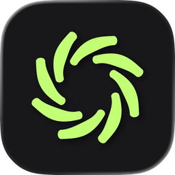
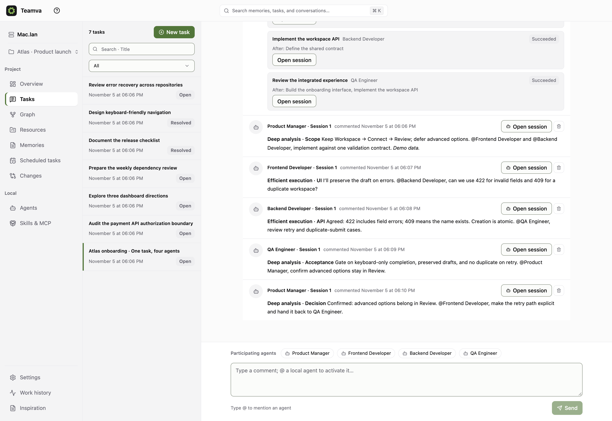
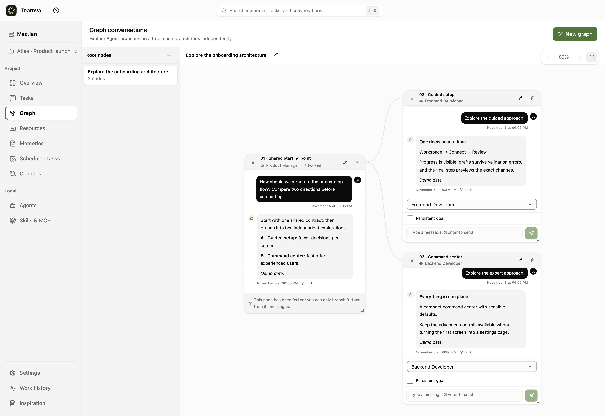
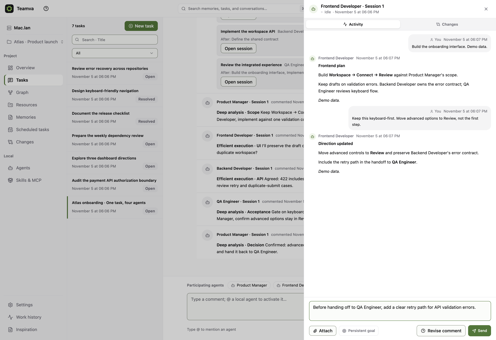
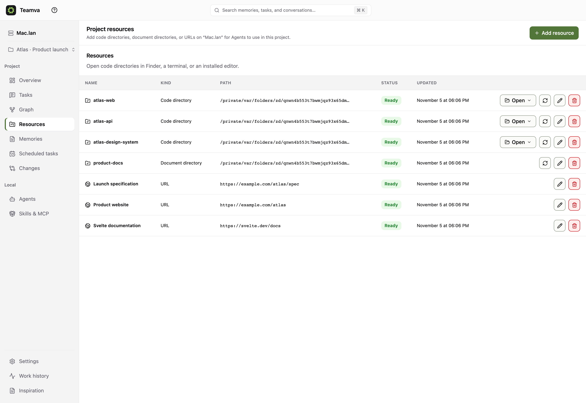
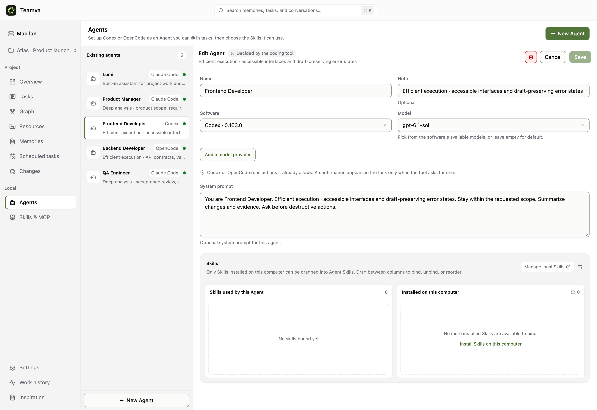
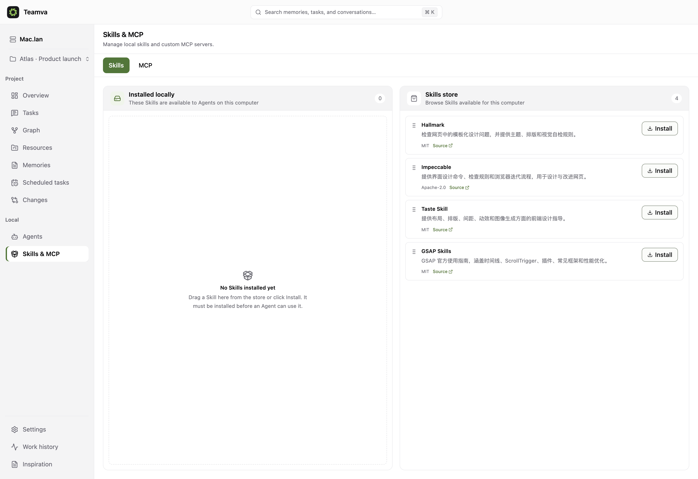
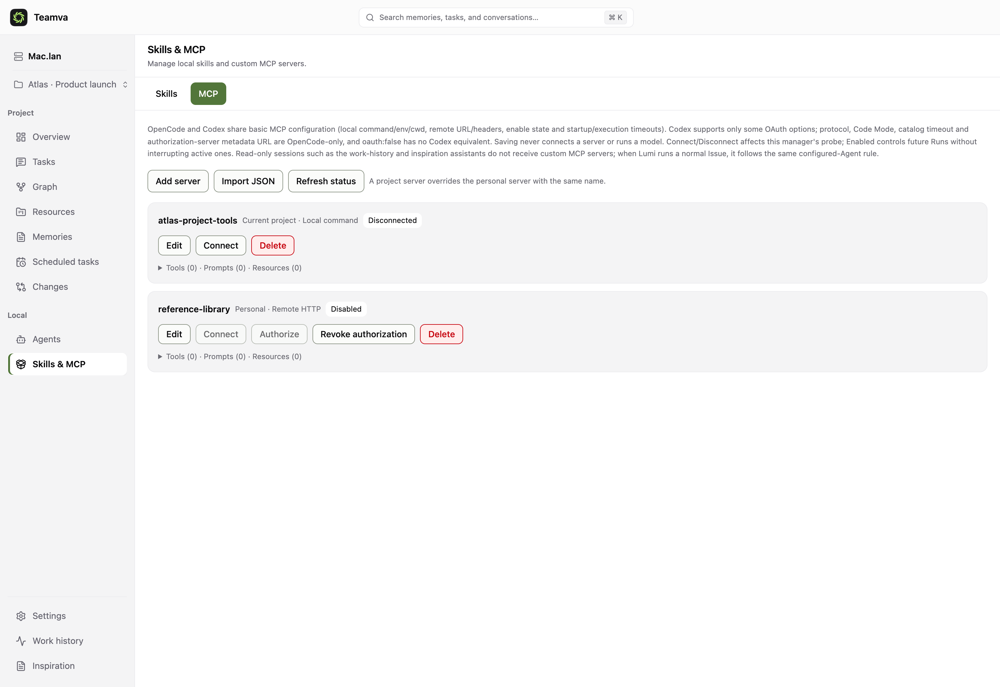
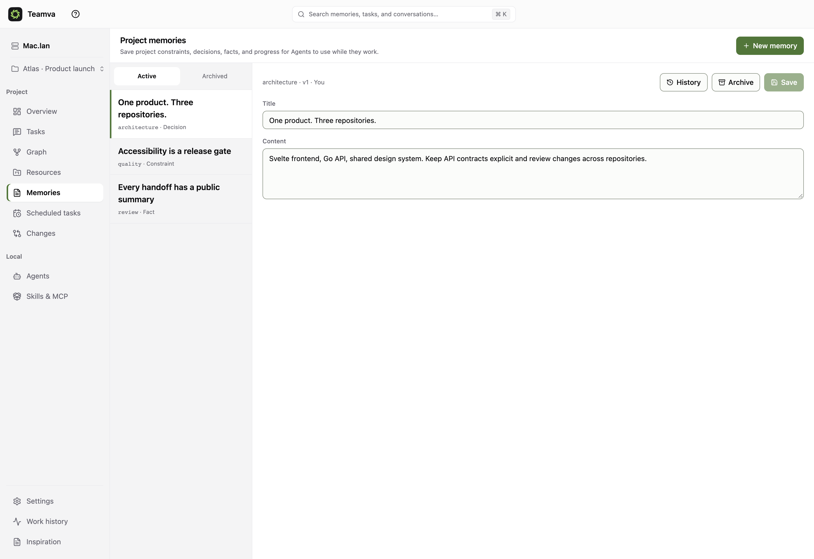

<div align="center">



# Teamva

### Your agents. One superpower.

**A local-first workspace for the Super-agent era.**<br/>
Multi-agent tasks. Branchable conversations. Your entire project in context.

**English** · [简体中文](PROJECT.zh-CN.md)

[Explore the workflow](#one-task-a-whole-team) · [Quick start](#quick-start) · [Documentation](docs/00-TeamVA-文档索引.md) · [Website source](website/)

</div>

### One task. Four roles. A shared conversation.



### One starting point. More than one direction.



> Real application screenshots, captured at **2× resolution**. The Atlas workspace, dialogue, completed assignments, and reviews are **prewritten demonstration data**, not evidence of live model execution or measured performance. [Reproduce the examples →](docs/SHOWCASE.md)

---

## Stop being the messenger between AI tabs

Coding agents can do real work. But when the frontend is in one session, the API is in another, and the reviewer needs both, **you become the coordination layer**: copying context, chasing progress, remembering which decision changed where.

**Teamva gives the work a home.** Define the outcome in a task. Give specialists explicit assignments. Open any agent's conversation. Explore alternatives on a graph. Keep repositories, documents, references, memory, Skills, and MCP configuration within reach.

Not another model. Not a terminal grid with a new name. **A persistent work layer around your coding agents.**

## The Super-agent moment, on your machine

DeepSeek's **Super-agent** research, made public on **October 31, 2026**, brings a useful question into focus: as agents get better at individual tasks, how do we stop human attention becoming the bottleneck across many tasks?

Its research explores coordination and execution layers, event-driven work, independent worker contexts, and continuity beyond a single chat. Teamva addresses the same practical coordination problem through a **local-first, visible workspace**:

- **Parallel work, not serial babysitting.** Independent agent instances can run concurrently; runs within an instance remain ordered.
- **Explicit handoffs, not copied transcripts.** Structured mentions and published results keep collaboration attached to the task.
- **Context with a home, not another forgotten tab.** Project resources, versioned memory, and branch snapshots keep the starting point legible.
- **Human control, not invisible autonomy.** Inspect activity, answer supported provider approvals, stop a run, or pause a session.

**Shared direction. Different system.** Teamva is independent of DeepSeek, is not endorsed by it, and is not an implementation of its research prototype. Teamva does **not** claim autonomous group-chat monitoring, a universal cross-channel memory, or execution while your machine is offline. The DeepSeek repository itself describes a research prototype, not a production product.

Sources: [DeepSeek's official prototype · Oct 31, 2026](https://github.com/deepseek-ai/dsh-superagent-prototype) · [People's Daily coverage · Nov 2, 2026](https://j.people.com.cn/n3/2026/1102/c94476-20514657.html). Research checked November 4, 2026. No benchmark results from another project are attributed to Teamva.

## Why Teamva

### Work as a team, without losing individual conversations

- **Specialists, not one overloaded persona.** Give agents distinct roles, system prompts, coding providers, models, and Skills.
- **Multiple tasks in one workspace.** Move between workstreams without reconstructing their participants, decisions, and history.
- **Real work assignments.** Split a task into named jobs, including multiple jobs for the same agent. Start independently or wait for explicit prerequisites.
- **Dependencies handled by the scheduler.** Downstream work waits for successful prerequisites and published results. No model needs to poll another agent.
- **A conversation behind every assignment.** Open a specialist's session, inspect its activity, and ask a targeted follow-up in that same session.
- **Visible delegation.** Agents hand work on through structured mentions and public comments. Indirect collaboration such as `A → B → A` is supported; direct self-mention is not.

### Think in branches, not overwritten prompts

- **Graph conversations.** Turn a reply into independent directions on a draggable, zoomable canvas.
- **Frozen shared context.** A branch carries a snapshot of its starting context rather than silently following later ancestor edits.
- **Continue both directions.** The existing conversation retains its continuation; the new branch starts at the chosen reply. Each writable node has its own agent and ordered runs.
- **A separate mode for exploration.** Graph conversations share project context but are not disguised Issue comments or automatic execution DAGs.

### Bring the whole project

- **Multiple repositories in one project.** Frontend, backend, design system, SDK—register the directories the work actually spans.
- **Documents alongside code.** Add a local document directory for specifications, decisions, and references.
- **Links and websites.** Keep reference URLs and product websites in the resource list. Registering a URL does not imply automatic crawling or synchronization.
- **Project memory.** Version facts, decisions, constraints, and progress; inspect history and archive or restore entries.
- **Skills with explicit installation.** Browse, install locally, then bind and order Skills per agent. Installed content is checked before use.
- **MCP where it belongs.** Manage personal and project configurations, inspect connections and capabilities, and use supported provider-native integrations on the next run. Project entries override same-name personal entries, including disabled ones.

### Operate the work, not just the chat

- **Live activity.** Streaming replies, tool events, approvals, retry and compaction states, and repository changes in one review surface.
- **Persistent execution state.** SQLite-backed control state, runtime state, command/event outboxes, and recovery paths—not just an in-memory conversation list.
- **Scheduled work.** Daily, weekly, one-off, and Cron schedules with IANA time zones, previews, run-now, and history. The machine and service must be running.
- **Persistent goals.** Goal workflows support continuation, independent review, completion gates, and optional token budgets. They are not a guarantee that every task succeeds.
- **Work history and inspiration.** Cross-project activity records, Markdown notes, and dedicated read-only assistant scopes for reviewing saved work.
- **Browser or native macOS window.** The same Svelte interface and local HTTP service, not two products that drift apart.
- **Make it yours.** Nine interface languages, seven light/dark palettes, and custom background, accent, and control colors.

## One task. A whole team.

**Example: ship onboarding across three repositories.**

1. The **Product Manager** defines the scope and acceptance criteria.
2. The **Frontend Developer** and **Backend Developer** implement in parallel and agree on validation behavior.
3. The **QA Engineer** reviews the integrated result and hands open questions back to the Product Manager.
4. You review the shared task, then open any specialist's session for a precise follow-up.

Assignments are explicit and editable before submission. Optional AI-assisted decomposition creates a draft for your confirmation; it does not silently start the work.

Match agents to the work: reasoning-focused agents for requirements and reviews, execution-focused agents for implementation.



Independent sessions do **not** imply independent filesystems. Agents can share project resources. Use separate directories or worktrees when concurrent edits require isolation; the worktree hint is not an automatic sandbox.

## Explore the fork before you commit

**Example: compare guided onboarding with an expert command center.** Start from one architectural answer. Fork at that answer, explore both directions with different agents, and keep their original shared context intact.

The graph screenshot at the top shows this workflow. It is for **branching conversations**, not a promise of automatic branch merging or arbitrary workflow programming.

## One project, more than one repository

**Example: Atlas launch context.** Three code directories, one document directory, the launch specification, the product website, and framework documentation—all registered in one project.



## Configure the specialists, not just the model

Choose each agent's coding engine, model, role, instructions, and installed Skills. A familiar name is a role you control—not a claim that every provider exposes the same tools.



**Provider support is explicit:** Codex and OpenCode are the main integrations. A controlled Claude Code adapter is also available for file and task tools; it does not expose shell, external MCP, or plugins. Features differ by provider. See [Provider API](docs/PROVIDER_API.md) and [Claude Code boundaries](docs/CLAUDE_PROVIDER.md).

## Expertise and tools, connected deliberately

Install Skills on your computer, then bind them to agents. Keep installation separate from activation.



Configure MCP services at personal or project scope. Connecting inspects the service's catalog; enabled configuration is injected into subsequent supported agent runs, without interrupting active work. The examples below are **not connected**; configuration is not proof of a working external integration.



Secrets remain in private local configuration files rather than public responses, run commands, events, or diagnostics. Custom MCP is not injected into global read-only assistant sessions. [MCP details →](docs/MCP.md)

## Make the next task start smarter

Turn constraints and decisions into versioned project memory instead of asking every new session to rediscover them.



## Local-first. Precisely.

The UI, Go HTTP API, SQLite stores, scheduler, and runtime controller run on your machine. No required Teamva cloud service, PostgreSQL, or Docker.

**Local control is not offline inference.** Coding agents may send prompts and selected code context to the configured model provider. Provider authentication, policies, availability, and charges still apply. No free-model promise is made.

The default listener is loopback-only. Optional password-protected LAN access must be enabled from the local settings page. Local and LAN access share one port. Remote clients cannot change the access switch or password; HTTP is only for trusted LAN/VPN use, **not public internet exposure or multi-user isolation**. [Remote access and trusted-device rules →](docs/REMOTE_ACCESS.md)

## Quick start

From a source checkout, install **Go 1.25.x**, **Node.js 24.x**, and **pnpm 11.x**. Configure the coding provider you intend to use. Desktop builds use Wails v2.13.x; browser use does not require Wails.

```bash
pnpm install
pnpm build
pnpm start:browser
```

Open the loopback URL in the log—normally `http://localhost:41720`, redirected to the same-port `127.0.0.1` origin. The page establishes a local session; no Teamva cloud account or copied bootstrap token is needed. Provider setup is separate.

For a new development build or an isolated evaluation, explicitly use a **new** data directory:

```bash
export TEAMVA_LOCAL_DATA_DIR="$(mktemp -d)"
pnpm start:browser
```

**Old database baselines are not upgraded.** A baseline or integrity failure preserves the database and refuses startup; never delete your normal data to make a build launch. Browser and Wails must not run separate service processes against the same directory. An already-running Wails service can also be opened in a browser.

### macOS app and drag-to-Applications DMG

```bash
pnpm --filter @teamva/web build
./scripts/desktop/stage-frontend.sh
(cd desktop && go run github.com/wailsapp/wails/v2/cmd/wails@v2.13.0 build)
open "desktop/build/bin/Teamva.app"
```

The release script produces a universal2 ZIP, a drag-to-Applications DMG, `VERSION`, and `SHA256SUMS`:

```bash
TEAMVA_VERSION="$(tr -d '\r\n' < VERSION)" ./scripts/release/build-desktop.sh
```

**Development preview:** artifacts are unsigned and not notarized. The DMG includes English and Chinese instructions for clearing quarantine from the trusted installed app; this is not code-signature removal. Updates are checksum-verified downloads, not automatic in-place replacement. Windows/Linux desktop packages and a public production release are not claimed. [Desktop build guide →](docs/DESKTOP_ARCHITECTURE.md)

### Marketing website

[`website/`](website/) is a separate **Svelte 5 + Vite** frontend—not SvelteKit. It includes the real product screenshots, an interactive tour, animated visual effects, and reduced-motion controls.

```bash
pnpm dev:website
pnpm build:website
```

## Built to be inspectable

```text
web/              Shared Svelte 5 + TypeScript interface
desktop/          Wails macOS shell, menus, diagnostics, updates
server/           Go local HTTP API, SQLite control plane, scheduling
node/provider/    Provider manifests and independent agent integrations
node/internal/    Runtime, FileBridge, ToolBroker
protocol/         OpenAPI and embedded runtime contracts
website/          Standalone Svelte + Vite marketing site
scripts/showcase/ Isolated examples and real Chrome screenshot checks
```

```bash
pnpm test:web        # UI unit tests
pnpm test:backend    # server + node + protocol + desktop
pnpm verify:web     # type checks, tests, production build
pnpm verify:backend # race tests and vet
```

Real browser, Wails, and provider/model acceptance are separate boundaries. A successful build is not evidence that all three were exercised. [Development and release rules](AGENTS.md) · [Architecture](ARCHITECTURE.md)

## Read deeper

[Work assignments](docs/ISSUE_WORK_ITEMS.md) · [Conversation forks](docs/CONVERSATION_FORKS.md) · [Goals](docs/CONVERSATION_GOALS.md) · [Skills & MCP](docs/MCP.md) · [Schedules](docs/PROJECT_SCHEDULES.md) · [Appearance](docs/APPEARANCE.md) · [Work history](docs/WORK_HISTORY.md) · [Inspiration](docs/INSPIRATIONS.md) · [All documentation](docs/00-TeamVA-文档索引.md)

**The point isn't to open more AI sessions. It's to make more of your work move forward—without making you hold every thread.**

## License and attribution

Original Teamva code, documentation and logo artwork are licensed under the
[Apache License, Version 2.0](LICENSE), unless a file states otherwise. See
[NOTICE](NOTICE) for the project source identifier and Silken logo attribution,
and [third-party notices](THIRD_PARTY_NOTICES.md) for separately licensed material.
NOTICE is informational and does not add conditions to the license or require
downstream projects to display or retain logo image files.
