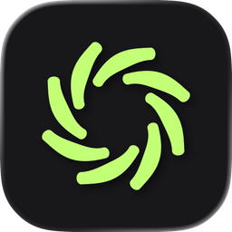
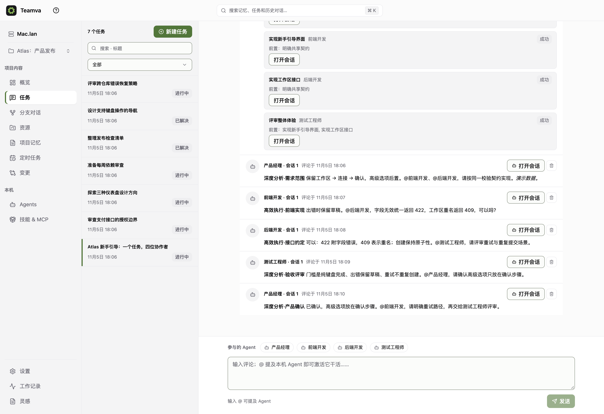
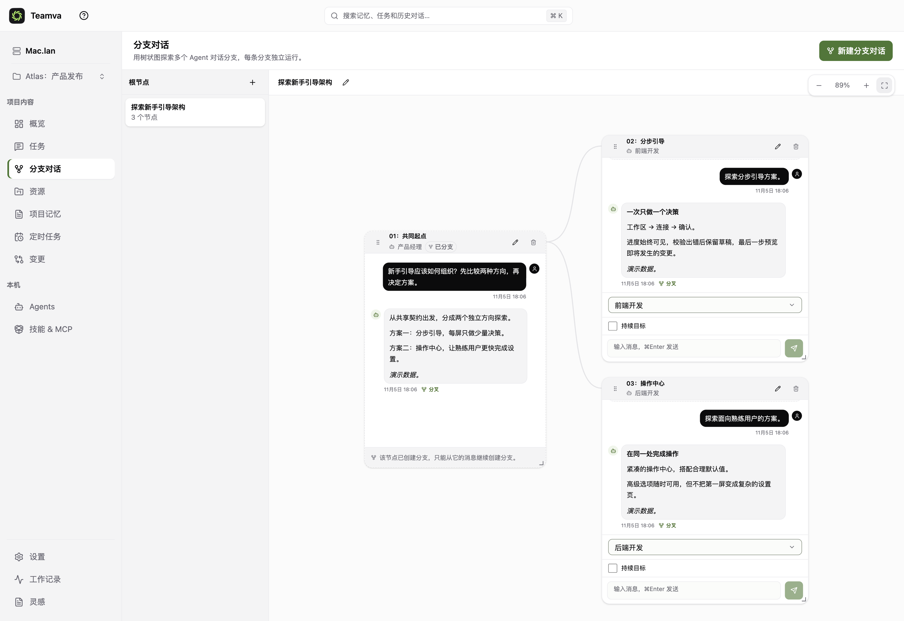
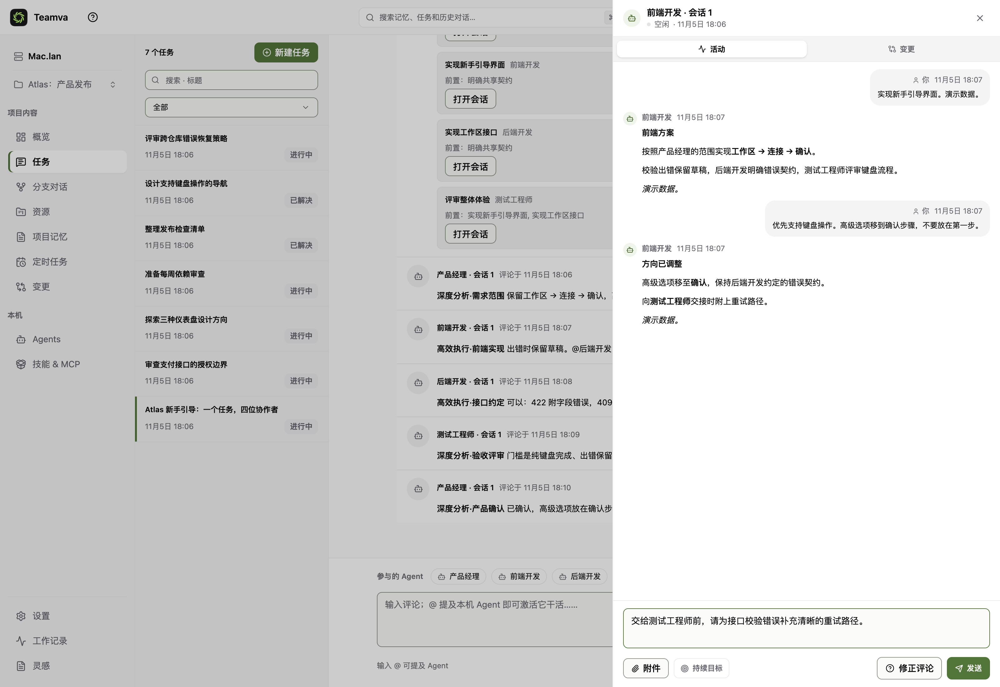
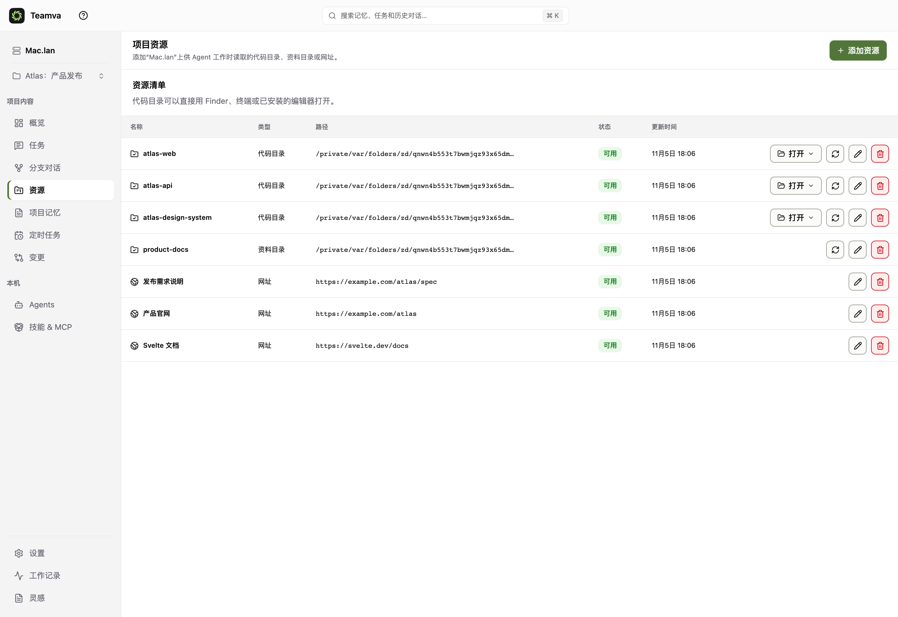
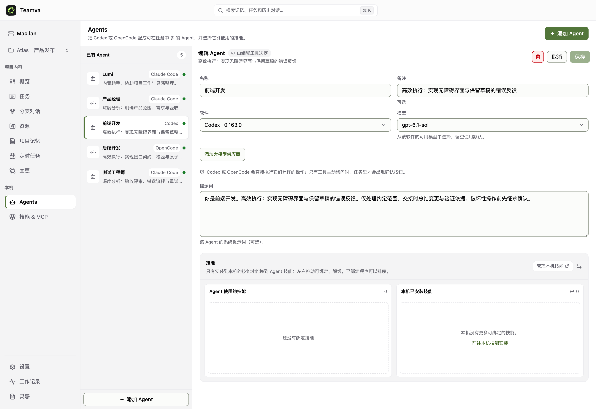
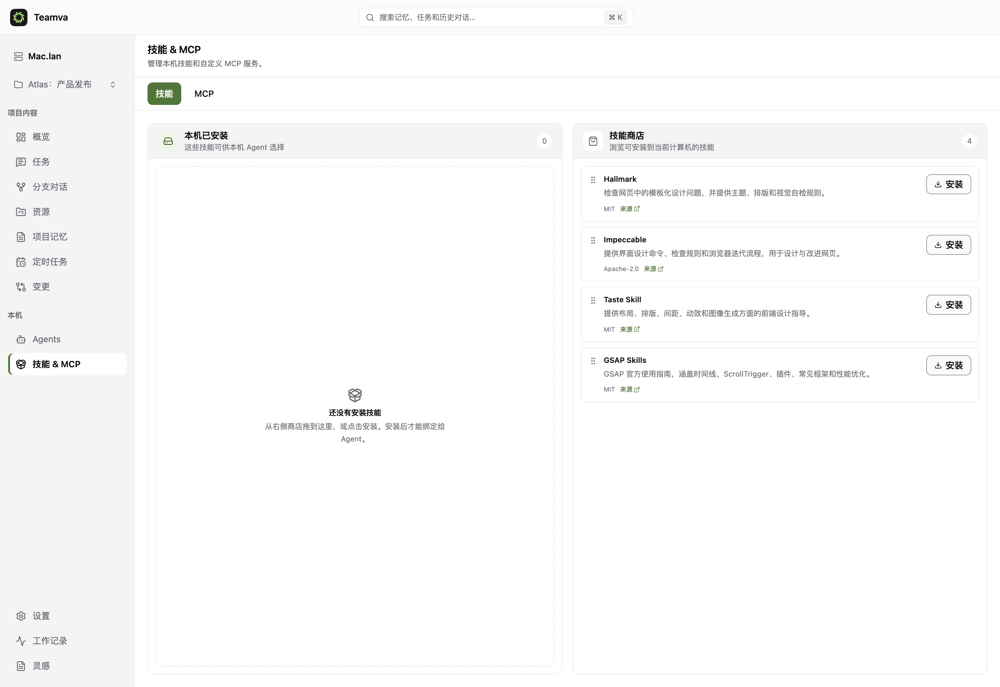
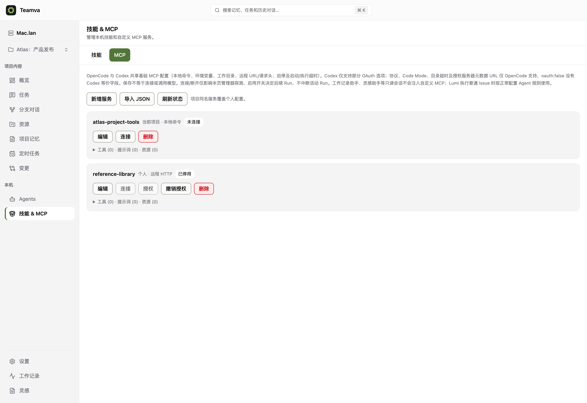
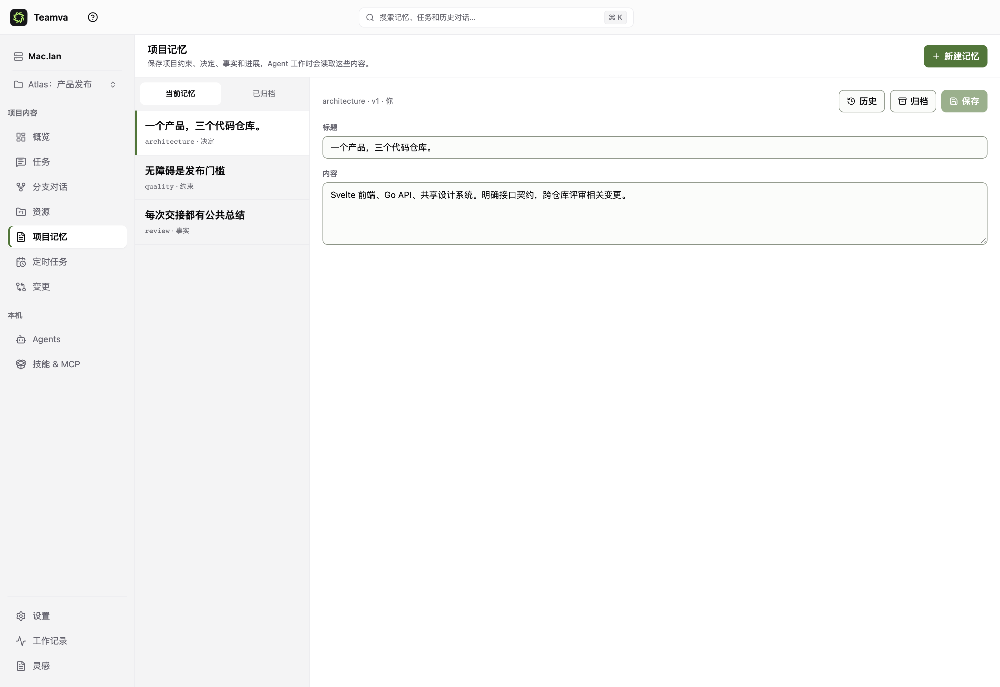

<div align="center">



# Teamva

### 你的 Agents，协作成一支团队。

**面向 Super-agent 时代的本地优先工作台。**<br/>
多 Agent 任务 · 可分叉的图对话 · 属于整个项目的上下文

[English](PROJECT.md) · **简体中文**

[看看工作流](#一个任务一支团队) · [快速开始](#快速开始) · [完整文档](docs/00-TeamVA-文档索引.md) · [官网源码](website/)

</div>

### 一个任务，四种岗位，在同一处讨论与交接



### 同一个起点，不止一种可能



> 截图来自真实应用，以 **2× 分辨率**采集。Atlas 项目、对话、已完成分工与评审均为**预先编写的演示数据**，不是实时模型执行结果或性能测试证据。[复现示例 →](docs/SHOWCASE.md)

---

## 不要再做 AI 窗口之间的传话人

前端在一个会话里，后端在另一个会话里，评审又需要两边的上下文。Agent 越能干，你越像调度员：复制背景、追问进度、记住哪个方案刚刚改过。

**Teamva 给工作一个共同的家。** 在任务里定义结果，给专家分配明确的工作，随时打开任何 Agent 的对话，在图上探索不同方向。代码仓库、文档、链接、项目记忆、Skills 和 MCP 配置，都有自己的位置。

不是新模型，也不只是换了一层皮的终端矩阵。**它是编程 Agent 之上的持久协作层。**

## Super-agent 时代，落到你的工作台

DeepSeek 于 **2026 年 10 月 31 日**公开的 **Super-agent** 研究，将一个关键问题摆到台前：当模型越来越擅长完成单项任务，如何不让人的注意力成为多任务的瓶颈？

研究讨论协调与执行分层、事件驱动、独立 Worker 上下文与跨会话连续性。Teamva 面对的是相近的协作问题，选择了**本地优先、过程可见的工作台**：

- **并行推进，而不是轮流盯梢。** 不同 Agent 实例可以并行，同一实例内的 Run 保持串行。
- **结构化交接，而不是复制聊天记录。** 明确的 @ 和公开总结，把协作留在任务里。
- **上下文有归属，而不是散落在窗口里。** 项目资源、版本化记忆和分叉快照，让每次开始更清楚。
- **自主执行不等于失去控制。** 查看活动、处理支持的 Provider 审批、停止 Run 或暂停会话。

**方向相近，系统不同。** Teamva 是独立项目，与 DeepSeek 没有隶属、背书或合作关系，也不是其研究原型的实现。我们不宣称具备自主监听群聊、统一跨平台记忆、电脑离线后继续执行等能力。DeepSeek 的官方仓库也明确将其定位为研究原型，而非生产产品。

来源：[DeepSeek 官方原型 · 2026-10-31](https://github.com/deepseek-ai/dsh-superagent-prototype) · [人民网报道 · 2026-11-02](https://j.people.com.cn/n3/2026/1102/c94476-20514657.html)。资料核实于 2026-11-04，不将其他项目的实验数据当作 Teamva 的成绩。

## 为什么选 Teamva

### 像团队一样协作，又保留每个人的对话

- **专家分工，不是一个无限膨胀的人设。** 每个 Agent 都可设置角色、系统提示词、编程 Provider、模型与 Skills。
- **多个任务，一个工作台。** 切换工作时，不必重新拼凑参与者、历史和决策。
- **真正明确的工作分配。** 一个任务可拆成多项工作，同一 Agent 也能负责多份独立工作。选择立即开始，或等待指定前置工作。
- **由调度器处理依赖。** 前置工作成功且发布结果后，才释放后续工作；不让模型轮询另一个 Agent。
- **每份工作背后都有独立会话。** 打开执行者的活动记录，在同一会话内精准追问。
- **交接留痕。** 结构化 @ 与公开评论记录协作，支持 `A → B → A` 间接循环，禁止直接 @ 自己。

### 用分支思考，而不是覆盖上一个提示词

- **图对话。** 从一条回复分出不同方向，在可拖动、可缩放的画布上探索。
- **冻结共同起点。** 分支继承创建时的上下文快照，不被祖先后续修改悄悄改变。
- **两条路都能继续。** 原对话保留完整续聊，新分支从选定回复出发；每个可写节点拥有自己的 Agent 和串行 Run。
- **探索与任务协作各有边界。** 图对话共用项目上下文，但不是伪装的 Issue 评论，也不是自动执行的任意 DAG 编程器。

### 把整个项目带进来

- **一个项目，多个代码仓库。** 前端、后端、设计系统、SDK，资源范围由实际工作决定。
- **文档与代码并列。** 将本地文档目录用于规格、约束、决策与参考资料。
- **链接与网站也有位置。** 在资源列表保留参考 URL 与产品网站。登记 URL 不代表自动爬取、索引或同步。
- **版本化项目记忆。** 保存事实、决策、约束与进展，查看历史、归档和恢复。
- **Skills 显式安装。** 先浏览并完整安装到本机，再为 Agent 绑定和排序，使用前检查安装内容。
- **MCP 按作用域管理。** 支持个人与项目配置、连接与能力目录检查，按 Provider 原生能力注入下一次 Run；项目同名配置覆盖个人配置，禁用项同样生效。

### 管理工作，而不仅仅是聊天

- **实时活动。** 流式输出、工具调用、审批、重试、上下文整理与仓库变更，在同一处观察。
- **执行状态持久化。** SQLite 控制面、运行状态、命令/事件 outbox 与恢复链路，而非只有内存里的会话列表。
- **定时任务。** 日、周、单次与 Cron，支持 IANA 时区、预览、立即运行和历史。电脑与服务必须保持运行。
- **持续目标。** 支持续跑、独立审核、完成门禁与可选 Token 预算；不是对任意任务必然成功的保证。
- **工作记录与灵感。** 跨项目查看活动，保存 Markdown 灵感，使用专属只读助手回顾已保存内容。
- **浏览器与原生 macOS 窗口。** 共用 Svelte UI 和本地 HTTP 服务，而非两套渐行渐远的产品。
- **按你的习惯工作。** 九种界面语言、七套明暗配色、自定义背景、强调色与控件色。

## 一个任务，一支团队

**示例：跨三个仓库交付 onboarding。**

1. **产品经理**定义需求范围与验收条件。
2. **前端开发**与**后端开发**并行实现，并在任务中确认校验契约。
3. **测试工程师**评审整体结果，将待确认问题交回产品经理。
4. 你查看公共任务，再打开任意专家的会话追问细节。

分工在提交前可以明确编辑。可选的 AI「帮我拆分」只产生待确认草案，不会悄悄启动工作。

让擅长深度分析的 Agent 负责需求与评审，让执行高效的 Agent 推进实现。



独立会话**不等于文件系统隔离**。Agent 可能访问同一份项目资源；并行修改需要隔离时，请使用不同目录或 worktree。worktree 提示不是自动安全沙箱。

## 先探索分叉，再做决定

**示例：对比引导式设置与专家命令中心。** 从同一条架构回复分叉，交给不同 Agent 探索，保留共同起点，让两个方向都能继续。

顶部图对话截图展示的就是这套流程。它是**可分支的对话**，不代表自动合并分支或通用流程编程。

## 一个项目，不止一个仓库

**Atlas 示例资源：** 三个代码目录、一个文档目录、发布规格、产品网站与框架文档，集中登记在同一个项目。



## 配置专家，而不只是选一个模型

为每位 Agent 选择编程引擎、模型、角色、提示词与已安装 Skills。角色由你定义，Provider 的真实能力边界不会被抹平。



**Provider 支持有明确范围：** Codex 与 OpenCode 是主要接入；也提供受控 Claude Code 适配器，仅开放文件与任务工具，不开放 Shell、外部 MCP 或插件。不同 Provider 的能力并不相同。[Provider API](docs/PROVIDER_API.md) · [Claude Code 边界](docs/CLAUDE_PROVIDER.md)

## 专长与工具，有意识地接进来

先安装本地 Skills，再给 Agent 绑定，让安装与执行各自明确。



按个人或项目配置 MCP 服务。显式连接用于能力目录探测；启用配置供支持的 Provider 在后续 Run 使用，不打断活动工作。截图中的服务示例均**未连接**，配置存在不代表外部集成已经验证可用。



秘密保存在本机私有配置文件中，不进入公开响应、Run 命令、事件或诊断；自定义 MCP 不注入全局只读助手会话。[MCP 说明 →](docs/MCP.md)

## 让下一次任务，从更好的地方开始

把约束与决定保存为版本化项目记忆，不必让新会话一再重新发现。



## 本地优先，边界说清

UI、Go HTTP API、SQLite、调度器与 Runtime Controller 都运行在你的机器上。不要求 Teamva 云服务、PostgreSQL 或 Docker。

**本地控制不等于离线推理。** 编程 Agent 仍可能将提示词和代码上下文发送给其配置的模型供应商；供应商认证、数据政策、可用性与费用照常适用，不承诺免费模型。

默认只监听 loopback。局域网访问必须在本机设置中显式启用并配置密码，本机与局域网共用一个端口。远程客户端不能修改开关或密码。HTTP 只适用于可信 LAN/VPN，**不是公网服务，也不是多用户安全隔离**。[远程访问与信任设备规则 →](docs/REMOTE_ACCESS.md)

## 快速开始

源码环境需要 **Go 1.25.x、Node.js 24.x、pnpm 11.x**，并配置实际要使用的编程 Provider。桌面构建使用 Wails v2.13.x；浏览器使用不需要 Wails。

```bash
pnpm install
pnpm build
pnpm start:browser
```

打开日志里的 loopback 地址，通常是 `http://localhost:41720`，会规范跳转至同端口 `127.0.0.1`。页面自动建立本机会话，无需 Teamva 云账号，也不用复制 bootstrap 令牌。Provider 的认证和模型配置独立处理。

新开发构建或隔离试用，必须显式选择**新的**数据目录：

```bash
export TEAMVA_LOCAL_DATA_DIR="$(mktemp -d)"
pnpm start:browser
```

**不升级旧数据库基线。** 基线或 integrity 校验失败时，保留数据库并拒绝启动。不要为启动新构建而删除日常数据。浏览器与 Wails 不应同时启动两个服务进程使用同一目录；已有 Wails 服务也可从浏览器打开。

### macOS 应用与拖动安装 DMG

```bash
pnpm --filter @teamva/web build
./scripts/desktop/stage-frontend.sh
(cd desktop && go run github.com/wailsapp/wails/v2/cmd/wails@v2.13.0 build)
open "desktop/build/bin/Teamva.app"
```

发布脚本产出 macOS arm64 与 x64 各自的 ZIP、可拖入 Applications 的 DMG、`VERSION` 与 `SHA256SUMS`：

```bash
TEAMVA_VERSION="$(tr -d '\r\n' < VERSION)" ./scripts/release/build-desktop.sh
```

**当前为开发预览：** macOS 制品使用 ad-hoc 签名，但未使用 Developer ID 签名、未公证。DMG 附中英文解除隔离说明，仅用于你信任的已安装应用；不是删除代码签名。更新采用校验下载，不在运行中自动替换应用；不宣称已有 Windows/Linux 桌面包或公开生产发布。[桌面构建说明 →](docs/DESKTOP_ARCHITECTURE.md)

### 品牌官网

[`website/`](website/) 是独立的 **Svelte 5 + Vite** 前端，**不用 SvelteKit**。包含真实截图、可切换产品导览、动态视觉效果，以及减少动效与暂停控制。

```bash
pnpm dev:website
pnpm build:website
```

## 架构与验证

```text
web/              Svelte 5 + TypeScript 共用界面
desktop/          Wails macOS 壳、菜单、诊断与更新
server/           Go 本地 HTTP API、SQLite 控制面与调度
node/provider/    Provider manifest 与各 Agent 的独立接入
node/internal/    Runtime、FileBridge、ToolBroker
protocol/         OpenAPI 与嵌入式运行协议
website/          独立 Svelte + Vite 品牌官网
scripts/showcase/ 隔离示例与真实 Chrome 截图检查
```

```bash
pnpm test:web
pnpm test:backend
pnpm verify:web
pnpm verify:backend
```

真实浏览器、真实 Wails 与真实 Provider/模型验收是不同证据，构建成功不能替代它们。[开发发布约定](AGENTS.md) · [架构](ARCHITECTURE.md)

## 深入了解

[工作分配](docs/ISSUE_WORK_ITEMS.md) · [对话分叉](docs/CONVERSATION_FORKS.md) · [持续目标](docs/CONVERSATION_GOALS.md) · [Skills & MCP](docs/MCP.md) · [定时任务](docs/PROJECT_SCHEDULES.md) · [外观](docs/APPEARANCE.md) · [工作记录](docs/WORK_HISTORY.md) · [灵感](docs/INSPIRATIONS.md) · [完整文档](docs/00-TeamVA-文档索引.md)

**重点不是再开几个 AI 窗口，而是让更多工作真正向前——不必每根线都攥在你手里。**

## 许可证与归属

除文件另有声明外，Teamva 自有代码、文档及 Logo 图形使用标准
[Apache License 2.0](LICENSE)。项目声明的源码标识及 Silken Logo 归属见
[NOTICE](NOTICE)，第三方材料的独立许可见 [第三方声明](THIRD_PARTY_NOTICES.md)。
NOTICE 仅记录归属，不增加许可证限制，也不要求下游展示或保留 Logo 图片文件。
